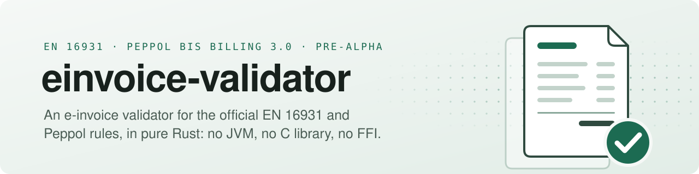

<picture>
  <source media="(prefers-color-scheme: dark)" srcset="banner-dark.svg">
  
</picture>

  <a href="https://einvoice-validator.github.io"><b>Website</b></a> ·
  <a href="https://github.com/einvoice-validator/einvoice-validator">Repository</a> ·
  <a href="https://github.com/einvoice-validator/einvoice-validator/issues">Issues and roadmap</a> ·
  <a href="https://github.com/einvoice-validator/einvoice-validator/blob/main/CHANGELOG.md">Changelog</a> ·
  <a href="https://github.com/einvoice-validator/einvoice-validator/security">Security</a>

  
  
  
  

European e-invoices are checked against business rules that CEN (EN 16931) and OpenPeppol (Peppol BIS Billing 3.0) publish as Schematron, which validators run compiled to XSLT 2.0. einvoice-validator is a library and a command-line tool, `einvoice-validate`, in **pure Rust** (no JVM, no C library, no FFI): an XSLT 2.0 and XPath 2.0 engine that runs those **official stylesheets unchanged**, with exact `xs:decimal` arithmetic and UBL 2.1 schema validation, and gives the same report as Saxon-HE, rule by rule.

> [!IMPORTANT]
> **Pre-alpha, no release yet: usable from source.** Install the command-line tool from a clone with `cargo install --locked --path crates/einvoice-cli`, or depend on the library through Git; nothing is published on crates.io, and before 1.0 the API may change. CEN EN 16931 UBL 1.3.17 is built in; Peppol BIS Billing 3.0.22 is used as a bundle built locally from its pinned release, whose files are not redistributed. On every case of both test corpora, official and mutated, the reports are the same as Saxon-HE 12.10's. Still open: the first release, WebAssembly bindings and an npm package, other rule sets. See the [website](https://einvoice-validator.github.io/#use) and the [tracking issues](https://github.com/einvoice-validator/einvoice-validator/issues).

| | Project | What it is |
|---|---|---|
| 🧾 | [**einvoice-validator**](https://github.com/einvoice-validator/einvoice-validator) | The Cargo workspace: the library (`einvoice-validator`) and the command-line tool (`einvoice-validate`, crate `einvoice-cli`), built on the XPath 2.0 parser (`einvoice-xpath`), atomic values (`einvoice-xdm`), evaluator (`einvoice-xpath-eval`), XSLT loader (`einvoice-xslt`) and executor (`einvoice-xslt-exec`) and UBL 2.1 schema validation (`einvoice-xsd`); the vendored CEN artefacts, the test corpus with its Saxon-HE results, and the scripts that build the Peppol corpus and bundle locally. |
| 🌐 | [**einvoice-validator.github.io**](https://github.com/einvoice-validator/einvoice-validator.github.io) | The website. |

#### Why trust it

- **Official artefacts, not a rewrite.** No rule is translated into Rust by hand: the engine executes the published stylesheets. The CEN artefacts are vendored byte for byte with their checksums, the Peppol release and its compiled stylesheets are checked against pinned checksums, and an instruction outside the supported XSLT subset is refused when the stylesheet is loaded.
- **Same reports as Saxon-HE.** Each test case carries the report Saxon-HE 12.10 gives, cross-checked against the expectations of the official unit tests (0 disagreements). The engine's report is identical to Saxon's, rule by rule, on all 1179 CEN EN 16931 UBL 1.3.17 cases and on all 707 Peppol BIS Billing 3.0.22 cases with each of its two stylesheets.
- **Mutation cases.** 504 CEN and 505 Peppol edits of the official examples, aimed at totals, rounding, decimal precision, dates, code lists, check digits and namespaces, give the same results as Saxon-HE too; they make 973 of the 982 distinct CEN asserts fire, against 235 with the official cases alone.
- **Schema validation compared with xmllint** on 1546 cases; every difference is listed with its cause.
- **Fast and small.** `einvoice-validate` checks the whole CEN corpus (1179 documents, XML, schema and rules, process start included) in about 0.6 s on one thread and 0.13 s on eight; Saxon-HE 12.10 runs the rules alone over the same documents in about 1.4 s on one thread, JVM start included. The loaded rule set keeps about 5.4 MiB of heap, and the library runs on `wasm32-unknown-unknown`.
- **Exact decimals.** `xs:decimal` is arbitrary precision, never a floating-point number.
- **Strict engineering.** No `unsafe`, every warning and clippy `pedantic` denied, signed commits, GitHub Actions pinned by commit SHA, dependencies checked by `cargo-deny`.

Need another official rule set (CII, XRechnung, Factur-X / ZUGFeRD, a national CIUS)? <a href="https://github.com/einvoice-validator/einvoice-validator/issues">Open an issue</a>.
